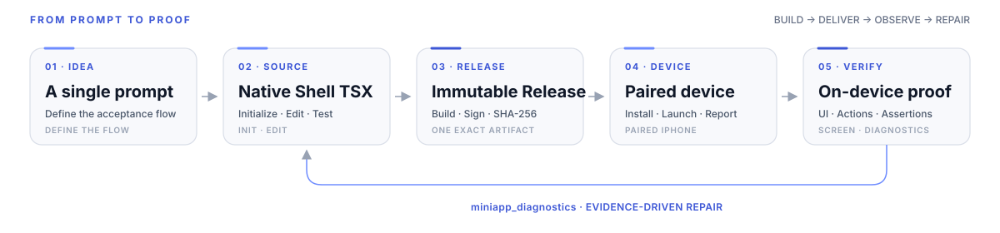

<div align="center">
  

  <h1>JieZi · Mini-app Development Mode</h1>

  <p><strong>From a single prompt to a verified mini-app on your iPhone.</strong></p>

  <p>
    A Native Shell mini-app development plugin for DeepSeek Harness.<br />
    Let your Agent initialize, code, build, sign, deploy, and repair on a real device.
  </p>

  <p>
    <a href="https://www.npmjs.com/package/dsh-jiezi"></a>
    <a href="https://github.com/FengWuFei/dsh-jiezi/actions/workflows/ci.yml"></a>
    <a href="https://github.com/deepseek-ai/deepseek-harness"></a>
    <a href="./LICENSE"></a>
  </p>

  <p>
    <a href="./README.md">简体中文</a> · <strong>English</strong>
  </p>

  <p>
    <a href="#installation">Installation</a> ·
    <a href="#your-first-delivery">Quick start</a> ·
    <a href="#toolbox">Tools</a> ·
    <a href="./docs/DETAIL.md">Technical details</a> ·
    <a href="./CHANGELOG.md">Changelog</a>
  </p>
</div>

---

> More than code generation. JieZi takes the Agent through the final mile: install the same immutable Release on a device, inspect its UI, perform actions, verify outcomes, and repair source from real diagnostics.

## From generation to delivery

| 🧠 A complete Agent | 🔁 An end-to-end loop | 👀 Semantic device verification | 🔐 Explicit pairing, local state |
| --- | --- | --- | --- |
| Official standard Agent capabilities plus one `miniapp` action tool and two skill-gated observation tools—not a closed mini-app-only shell. | From an empty directory to a signed Release, then installation, launch, and status on a device. | Inspect the UI tree, tap, type, scroll, and assert with screenshots and diagnostics as evidence. | QR codes are rendered locally. Keys, devices, and delivery records stay on your computer; initialization is always explicit. |

<picture>
  <source media="(prefers-color-scheme: dark)" srcset="./docs/assets/delivery-loop-en-dark.svg" />
  
</picture>

The bundled `jiezi-miniapp` Skill guides the Agent through this loop: **edited source or a successful compile is not delivery; the target flow must be verified on the intended device.**

## Installation

| Component | Requirement |
| --- | --- |
| DeepSeek Harness | `>=0.2.2-rc.1 <0.3.0`; enforced through `engines.dsh` |
| Native Shell toolchain | Provided on macOS arm64 by the optional `jiezi-nsh-darwin-arm64` dependency. On other platforms, install `nsh` yourself and expose it through `NSH_TOOLCHAIN` or `PATH` |
| Debug target | Deployment, screenshots, and semantic verification require a simulator or paired iPhone with the JieZi Host App. Build and signing alone need no device |

### Option 1 · Plugin index (recommended)

In DSH, open **Plugins → Discover**, choose **Add index source**, and enter:

```text
https://raw.githubusercontent.com/FengWuFei/dsh-jiezi/main/index.json
```

**JieZi development mode** will appear in the list. Install it directly—the index installs `dsh-jiezi` from npm and simply saves you from typing the package name.

<details>
<summary>GitHub unreachable? Use the jsDelivr mirror</summary>

```text
https://cdn.jsdelivr.net/gh/FengWuFei/dsh-jiezi@main/index.json
```

The mirror can lag the latest release by up to 12 hours. If **Discover** is not visible, enable the plugin index under **Settings → Experimental plugins** first.

</details>

### Option 2 · Install the npm package directly

Enter `dsh-jiezi` in the DSH **Plugins** page, or use a terminal:

```sh
dsh plugin --profile desktop add dsh-jiezi
dsh plugin --profile web add dsh-jiezi
```

Restart DSH when prompted. Replacing an installed plugin also requires a restart before the new Host code can load.

<details>
<summary>Offline installation</summary>

Download `dsh-jiezi-<version>.tgz` from [GitHub Releases](https://github.com/FengWuFei/dsh-jiezi/releases/latest), then add the plugin using:

```text
file:/absolute/path/dsh-jiezi-<version>.tgz
```

</details>

## Your first delivery

### 1. Initialize the development environment

After installation and restart, **JieZi** appears in the sidebar. Open the panel and choose **Initialize development environment**. The plugin creates development keys, TLS configuration, and bridge state in `~/.jiezi`.

This happens only after your explicit action; **activating the plugin never creates trust material by itself.**

### 2. Pair your iPhone

Click the pairing QR code in the panel and scan it with an iPhone running the JieZi Host App. The QR code is generated locally in the browser, shows its remaining lifetime, and refreshes automatically after expiry.

**Check environment** verifies the bridge, `nsh`, Host version, and automation state in one pass.

### 3. Start a conversation

Create an **empty directory** as the Session working directory, select the **JieZi development mode** preset, and ask:

> Use the miniapp tool's init action to create a counter mini-app called hello. Build and deploy it to my iPhone, then verify that tapping “+1” updates the count correctly.

The Agent works through the delivery loop instead of stopping at source code:

```text
miniapp(init) → miniapp(build) → miniapp(deploy) → miniapp(status, wait: true)
                                        ↓
miniapp(diagnostics) ← miniapp_action(expect) ← miniapp_ui(outline)
```

When the environment is uncertain, ask the Agent to run the `miniapp` `doctor` action first. For a stuck instance or blocking Host alert, use `action: "reload"` rather than deploying the same Release again.

> [!NOTE]
> Every Release is one signed `.jz` container: besides the executable payload it carries the app-library icon, summary, `docs/about.md` description, and capability purposes. Those are project source (`init` creates them) and can be edited directly; the build reports oversized summaries, HTML in the description, wrong icon size/color space, or missing sensitive-capability purposes with stable `JZ_*` codes.

> [!NOTE]
> By default, the `init` action uses the **Session working directory itself** as the project root, and that directory must be empty. To keep multiple mini-apps in one directory, set `projectLayout` to `named-subdirectory` on `jiezi-tools`; projects will be created at `<working directory>/<projectId>`.

> [!NOTE]
> **1.1.3 collapses the tool surface.** Start a new session after upgrading; old sessions do not gain the three-tool surface. `miniapp_ui`/`miniapp_action` appear after the `jiezi-miniapp` skill loads (one step later for a UI-invoked skill); if they are still missing after a resume, have the Agent call `skill` again.

> [!TIP]
> **Upgrades preserve pairing.** After a plugin update, DSH restart, or bridge restart, pairing is restored from `~/.jiezi` (or your configured `stateDir`). Your iPhone reconnects with its existing credentials—no reinitialization or QR scan required.

## Toolbox

| Tool | Visible when | Covers |
| --- | --- | --- |
| `miniapp` (action enum) | Always | `init` / `build` / `deploy` / `status` / `reload` / `open` / `device` / `doctor` / `diagnostics` |
| `miniapp_ui` | After the `jiezi-miniapp` skill loads | `mode: "outline"` semantic UI tree, `mode: "capture"` page tree plus screenshot, `mode: "screen"` full-device PNG |
| `miniapp_action` | After the `jiezi-miniapp` skill loads | Tap, type, scroll, and multi-condition assertions; failures are returned as data, never disguised as success |

Every former per-verb tool (`miniapp_init/build/deploy/status/reload/open/doctor/capture/screen/devices/device/diagnostics`)
maps onto an action or mode above; no capability was removed. `deploy` still
wakes the Agent that started it, `status` still supports a blocking wait,
`capture` keeps the tree truncation and `requestId` re-read, and `screen` still
captures the full device through the Host. Exact parameters, results and error
codes are in the [skill tool reference](./skills/jiezi-miniapp/references/tool-reference.md).

See [technical details](./docs/DETAIL.md) for protocols, error semantics, and automation boundaries. The Agent-facing development contract lives in the [`jiezi-miniapp` Skill](./skills/jiezi-miniapp/SKILL.md).

## Configuration

Both `jiezi-runtime` and `jiezi-tools` accept the first five options; `projectLayout` applies only to `jiezi-tools`.

| Option | Default / behavior |
| --- | --- |
| `socketPath` | `$JIEZI_BRIDGE_SOCKET`, falling back to `~/.jiezi/bridge.sock` |
| `stateDir` | The parent directory of `socketPath` |
| `bridgeCliPath` | Resolves `$JIEZI_BRIDGE_CLI`, packaged `lib/bridge/cli.js`, then repository `vendor/bridge/src/cli.js` |
| `autoStart` | Enabled in the shipped configuration; the supervisor starts and monitors the bridge on demand |
| `timeoutMs` | `30000` |
| `projectLayout` | `working-directory`; alternatively `named-subdirectory` |
| `activationSkills` | `jiezi-tools` only; defaults to `['jiezi-miniapp']` and admits `miniapp_ui`/`miniapp_action` after that skill loads |

See [docs/DETAIL.md](./docs/DETAIL.md) for bridge identity checks, Host lifecycle recovery, and safe-repair rules.

## Security, data, and scope

- **Explicit trust**: Development keys and TLS configuration are created only after you click Initialize.
- **Local pairing**: The bridge produces the pairing payload and the browser renders its QR code locally; no third-party QR service is involved.
- **Minimal environment**: Bridge subprocesses inherit only necessary variables such as `PATH`, `HOME`, `TMPDIR`, `NSH*`, and `DEVELOPER_DIR`.
- **Credential isolation**: The plugin does not read or export model-provider credentials. Pairing credentials and development data remain in the local state directory.
- **Controlled cleanup**: Uninstalling the plugin does not delete projects, artifacts, devices, or keys under `~/.jiezi`. Remove that directory manually only when you want to erase them.
- **Development scope**: This repository does not include the JieZi iOS App, production signing certificates, or a Linux build service. It does not provide APNs, automatic IPA installation, or device unlocking.

> [!IMPORTANT]
> Host `0.1.x` may still show the legacy frozen-snapshot alert. The plugin reports the installed and minimum required versions in device, delivery, and diagnostic results. The `miniapp` `reload` action can create a fresh instance, but updating the Host App is the permanent fix.

## Development and contributing

Node.js `>=20` is required. Feedback is welcome through [Issues](https://github.com/FengWuFei/dsh-jiezi/issues), as are focused Pull Requests with verification results.

```sh
npm install
npm run typecheck    # TypeScript static checks
npm run build        # esbuild → lib/*.js and copy the vendored bridge
npm test             # build + node --test test/*.test.js
npm run test:bridge  # Tests for the vendored bridge itself
```

| Directory | Contents |
| --- | --- |
| `src/host` | Tool registration, bridge client, process supervision, and device lifecycle |
| `src/client` | Sidebar panel, local QR rendering, and pairing interactions |
| `skills/jiezi-miniapp` | Development Skill, Native Shell API snapshot, and repair guides |
| `vendor/bridge` | Exact-version `jiezi-bridge` snapshot synchronized from the main repository |
| `scripts` | Build, bridge sync, index generation, and toolchain packaging |

<details>
<summary><strong>For maintainers: bridge sync and releases</strong></summary>

`vendor/bridge/` is synchronized from the main repository and is not developed independently here. The plugin pins the exact version in `vendor/bridge/package.json`:

```sh
node scripts/sync-bridge.mjs --from /path/to/JieZi/companion/bridge
```

To release, update the version and push the commit with its tag:

```sh
npm version patch  # or minor / major
git push --follow-tags
```

The tag triggers the [Release workflow](./.github/workflows/release.yml): run tests, publish an npm package with provenance through GitHub OIDC Trusted Publishing, verify the registry, generate and commit `index.json`, and attach the offline tgz to a GitHub Release. No npm token is stored in this repository; register this repository's `release.yml` as a trusted publisher in the npm package settings.

To retry an existing tag, open **Actions → Release → Run workflow** and enter the same `v*` tag. The workflow checks out that tag's source, applies only the generated index to the latest `main`, and updates the existing Release assets. Never delete or move the tag.

`jiezi-nsh-darwin-arm64` is published as a separate toolchain package. Its source is under `packages/nsh-darwin-arm64/`; `scripts/pack-nsh.mjs` packages artifacts from the local `NSH_TOOLCHAIN`, and binaries are kept out of git.

</details>

Releases follow [SemVer](https://semver.org/). See the [CHANGELOG](./CHANGELOG.md) for version-by-version changes.

## License

[MIT](./LICENSE) © 2026 FengWuFei. The optional bundled toolchain `jiezi-nsh-darwin-arm64` includes the Apache-2.0 license from [Native Shell](https://github.com/longbridge/nsh).

---

<div align="center">
  <p><strong>Move code beyond the editor. Verify it on a real device.</strong></p>
  <p>
    <a href="https://github.com/deepseek-ai/deepseek-harness">DeepSeek Harness</a> ·
    <a href="https://github.com/longbridge/nsh">Native Shell</a> ·
    <a href="https://github.com/FengWuFei/dsh-jiezi">JieZi</a>
  </p>
  <p>If JieZi helps your workflow, a ⭐ is always appreciated.</p>
</div>
