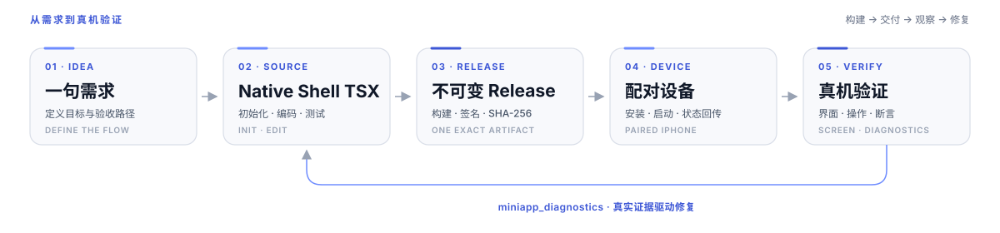

<div align="center">
  

  <h1>JieZi · 芥子开发模式</h1>

  <p><strong>从一句需求，到 iPhone 上可验证的小程序。</strong></p>

  <p>
    为 DeepSeek Harness 打造的 Native Shell 小程序开发插件。<br />
    让 Agent 完成初始化、编码、构建、签名、真机交付与诊断修复。
  </p>

  <p>
    <a href="https://www.npmjs.com/package/dsh-jiezi"></a>
    <a href="https://github.com/FengWuFei/dsh-jiezi/actions/workflows/ci.yml"></a>
    <a href="https://github.com/deepseek-ai/deepseek-harness"></a>
    <a href="./LICENSE"></a>
  </p>

  <p>
    <strong>简体中文</strong> · <a href="./README.en.md">English</a>
  </p>

  <p>
    <a href="#安装">安装</a> ·
    <a href="#第一次交付">快速开始</a> ·
    <a href="#工具全景">工具</a> ·
    <a href="./docs/DETAIL.md">技术细节</a> ·
    <a href="./CHANGELOG.md">更新日志</a>
  </p>
</div>

---

> 不只是“写出代码”。芥子把 Agent 的工作延伸到最后一步：将同一个不可变 Release 安装到设备，读取界面、执行操作、验证结果，再依据真实诊断修复源码。

## 把“生成”推进到“交付”

| 🧠 标准 Agent | 🔁 完整交付闭环 | 👀 语义级真机验证 | 🔐 显式配对与本地状态 |
| --- | --- | --- | --- |
| 官方标准 Agent 能力 + 一个 `miniapp` 动作工具与两个技能门控的观察工具，不是封闭的小程序工具集。 | 从空目录到已签名 Release，再到设备安装、启动与状态回传。 | 读取界面树，执行点击、输入、滚动和断言，结合截图与诊断定位问题。 | 二维码在本地生成；密钥、设备与交付记录保存在本机，初始化由你主动触发。 |

<picture>
  <source media="(prefers-color-scheme: dark)" srcset="./docs/assets/delivery-loop-zh-dark.svg" />
  
</picture>

内置的 `jiezi-miniapp` Skill 会引导 Agent 遵循这条路径：**源码修改或编译成功，不等于交付完成；目标流程经过设备验证，才算完成。**

## 安装

| 组件 | 要求 |
| --- | --- |
| DeepSeek Harness | `>=0.2.2-rc.1 <0.3.0`，版本约束已写入 `engines.dsh` |
| Native Shell 工具链 | macOS arm64 由可选依赖 `jiezi-nsh-darwin-arm64` 提供；其他平台需自行安装 `nsh`，并通过 `NSH_TOOLCHAIN` 或 `PATH` 暴露 |
| 调试设备 | 部署、截图和语义验证需要安装芥子宿主 App 的模拟器或已配对 iPhone；纯构建与签名不需要设备 |

### 方式一 · 插件索引（推荐）

在 DSH 的 **「插件 → 发现」** 中点击 **「添加索引源」**，填入：

```text
https://raw.githubusercontent.com/FengWuFei/dsh-jiezi/main/index.json
```

列表中会出现 **「芥子开发模式」**，点击安装即可。安装的是 npm 上的 `dsh-jiezi`，索引只是省去手动输入包名。

<details>
<summary>GitHub 直连不畅？使用 jsDelivr 镜像</summary>

```text
https://cdn.jsdelivr.net/gh/FengWuFei/dsh-jiezi@main/index.json
```

镜像可能比最新发布晚最多 12 小时。如果看不到「发现」，请先在 **「设置 → 实验性插件」** 中启用插件索引。

</details>

### 方式二 · 直接安装 npm 包

在 DSH「插件」页的添加插件处输入 `dsh-jiezi`，或使用终端：

```sh
dsh plugin --profile desktop add dsh-jiezi
dsh plugin --profile web add dsh-jiezi
```

安装后按 DSH 提示重启；替换已安装插件时，也需要重启才能加载新的 Host 代码。

<details>
<summary>离线安装</summary>

从 [GitHub Releases](https://github.com/FengWuFei/dsh-jiezi/releases/latest) 下载 `dsh-jiezi-<版本>.tgz`，添加插件时填写：

```text
file:/绝对路径/dsh-jiezi-<版本>.tgz
```

</details>

## 第一次交付

### 1. 初始化开发环境

安装并重启后，侧栏会出现 **「芥子」**。打开面板，点击 **「初始化开发环境」**，插件会在 `~/.jiezi` 创建开发密钥、TLS 配置和桥接状态。

这一步只在你点击后执行；**激活插件本身不会创建任何信任材料。**

### 2. 配对 iPhone

点击面板中的配对二维码，用安装了芥子宿主 App 的 iPhone 扫描。二维码在浏览器本地生成，会显示剩余时间并在过期后自动更新。

**「检测环境」** 可以一次检查桥接、`nsh`、宿主版本和自动化状态。

### 3. 开始对话

新建一个**空目录**作为会话工作目录，选择 **「芥子开发模式」** 预设，然后直接告诉 Agent：

> 用 miniapp 工具的 init 动作创建一个叫 hello 的计数器小程序，构建并部署到我的 iPhone，再验证点击“+1”后数字会正确更新。

Agent 会沿着下面的闭环工作，而不是只给你一份源码：

```text
miniapp(init) → miniapp(build) → miniapp(deploy) → miniapp(status, wait: true)
                                        ↓
miniapp(diagnostics) ← miniapp_action(expect) ← miniapp_ui(outline)
```

环境状态不确定时，先让 Agent 调用 `miniapp` 的 `doctor` 动作；遇到卡住的实例或宿主弹窗，使用 `action: "reload"`，不要重复部署同一个 Release。

> [!NOTE]
> `miniapp` 的 `init` 动作默认把**会话工作目录本身**作为项目根，目录必须为空。如果一个目录要容纳多个小程序，请将 `jiezi-tools` 的 `projectLayout` 配置为 `named-subdirectory`，项目会创建在 `<工作目录>/<projectId>`。

> [!NOTE]
> 每次 Release 都是单个签名 `.jz`：除可执行载荷外，还带应用库展示所需的图标、摘要、`docs/about.md` 说明和能力用途。这些是项目源码（`init` 会生成），可直接编辑；构建会用稳定的 `JZ_*` 码指出摘要过长、说明含 HTML、图标尺寸/色彩空间不符或敏感能力缺用途等问题。

> [!NOTE]
> **1.1.3 收敛了工具面。** 升级后请新建会话：旧会话不会自动获得 `miniapp` 的三工具面；`miniapp_ui`/`miniapp_action` 在加载 `jiezi-miniapp` 技能后出现（从 UI 直接调用技能时晚一步），若恢复会话后仍不可见，让 Agent 再调用一次 `skill` 即可。

> [!TIP]
> **升级不会清空配对。** 插件更新、DSH 重启或桥接重启后，配对状态仍从 `~/.jiezi`（或配置的 `stateDir`）恢复，iPhone 使用原凭据自动重连，不需要重新初始化或扫码。

## 工具全景

| 工具 | 何时可见 | 覆盖 |
| --- | --- | --- |
| `miniapp`（action 枚举） | 常驻 | `init` / `build` / `deploy` / `status` / `reload` / `open` / `device` / `doctor` / `diagnostics` |
| `miniapp_ui` | 加载 `jiezi-miniapp` 技能后 | `mode: "outline"` 语义界面树、`mode: "capture"` 页面树与截图、`mode: "screen"` 设备全屏 PNG |
| `miniapp_action` | 加载 `jiezi-miniapp` 技能后 | 点击、输入、滚动与多条件断言；失败按数据返回，不会伪装成成功 |

原有的逐动作工具（`miniapp_init/build/deploy/status/reload/open/doctor/capture/screen/devices/device/diagnostics`）
全部收敛为上面的动作与模式，能力没有删除：`deploy` 仍会在终态唤醒发起它的 Agent，`status` 仍支持阻塞等待，
`capture` 仍保留树截断与 `requestId` 重读，`screen` 仍是宿主侧整屏截图。完整参数、返回值与错误码见
[Skill 工具参考](./skills/jiezi-miniapp/references/tool-reference.md)。

完整的协议、错误语义与自动化边界见 [技术细节](./docs/DETAIL.md)；Agent 使用的开发规范位于 [`jiezi-miniapp` Skill](./skills/jiezi-miniapp/SKILL.md)。

## 配置

`jiezi-runtime` 与 `jiezi-tools` 均接受前五项配置；`projectLayout` 仅用于 `jiezi-tools`。

| 配置项 | 默认值 / 说明 |
| --- | --- |
| `socketPath` | `$JIEZI_BRIDGE_SOCKET`，未设置时为 `~/.jiezi/bridge.sock` |
| `stateDir` | 默认取 `socketPath` 的父目录 |
| `bridgeCliPath` | 依次查找 `$JIEZI_BRIDGE_CLI`、包内 `lib/bridge/cli.js`、仓库内 `vendor/bridge/src/cli.js` |
| `autoStart` | 随包配置已开启，由 supervisor 按需启动并监督桥接 |
| `timeoutMs` | `30000` |
| `projectLayout` | `working-directory`；可改为 `named-subdirectory` |
| `activationSkills` | 仅 `jiezi-tools`；默认 `['jiezi-miniapp']`，技能加载后放行 `miniapp_ui`/`miniapp_action` |

桥接身份识别、宿主生命周期恢复及安全修复的详细规则，请阅读 [docs/DETAIL.md](./docs/DETAIL.md)。

## 安全、数据与边界

- **显式信任**：只有你主动点击初始化后，插件才会创建开发密钥与 TLS 配置。
- **本地配对**：配对载荷由桥接产生，二维码在浏览器本地渲染，不经过第三方二维码服务。
- **最小环境**：桥接子进程只继承 `PATH`、`HOME`、`TMPDIR`、`NSH*`、`DEVELOPER_DIR` 等必要环境变量。
- **凭据隔离**：插件不会读取或转存模型供应商凭据；配对凭据与开发数据保存在本机状态目录。
- **可控卸载**：卸载插件不会删除 `~/.jiezi` 中的项目、产物、设备与密钥；需要彻底清理时，请手动删除该目录。
- **开发态边界**：本仓库不包含芥子 iOS App、生产签名证书或 Linux 构建服务，也不提供 APNs、自动 IPA 安装和设备解锁。

> [!IMPORTANT]
> 宿主 `0.1.x` 仍可能出现旧版冻结快照提示。插件会在设备、部署和诊断结果中标出版本与最低要求；`miniapp` 的 `reload` 动作可以创建新实例，但根治仍需更新宿主 App。

## 开发与贡献

需要 Node.js `>=20`。欢迎通过 [Issues](https://github.com/FengWuFei/dsh-jiezi/issues) 反馈问题，或提交聚焦、带验证结果的 Pull Request。

```sh
npm install
npm run typecheck    # TypeScript 静态检查
npm run build        # esbuild → lib/*.js，并复制随包桥接
npm test             # build + node --test test/*.test.js
npm run test:bridge  # 随包桥接自身测试
```

| 目录 | 内容 |
| --- | --- |
| `src/host` | 工具注册、桥接客户端、进程监督与设备生命周期 |
| `src/client` | 侧栏面板、本地二维码与配对交互 |
| `skills/jiezi-miniapp` | 开发 Skill、Native Shell API 快照与修复指南 |
| `vendor/bridge` | 从主仓库同步的 `jiezi-bridge` 精确版本快照 |
| `scripts` | 构建、桥接同步、索引生成与工具链打包 |

<details>
<summary><strong>维护者：桥接同步与发布流程</strong></summary>

`vendor/bridge/` 由主仓库同步而来，不在本仓库单独开发；插件按 `vendor/bridge/package.json` 中的版本做精确锁定：

```sh
node scripts/sync-bridge.mjs --from /path/to/JieZi/companion/bridge
```

发布时先更新版本号，再推送提交和 tag：

```sh
npm version patch  # 或 minor / major
git push --follow-tags
```

tag 会触发 [Release 工作流](./.github/workflows/release.yml)：运行测试，通过 GitHub OIDC Trusted Publishing 发布带 provenance 的 npm 包，确认 registry 已更新，生成并提交 `index.json`，最后将离线 tgz 上传到 GitHub Release。仓库不保存 npm 令牌；只需在 npm 包设置中将本仓库的 `release.yml` 登记为可信发布者。

已有 tag 需要重跑时，打开 **Actions → Release → Run workflow**，输入同一个 `v*` tag。工作流会检查该 tag 的源码，只将生成的索引应用到最新 `main`，并更新已有 Release 的附件，不需要删除或移动 tag。

`jiezi-nsh-darwin-arm64` 是独立发布的工具链包，源码位于 `packages/nsh-darwin-arm64/`；产物由 `scripts/pack-nsh.mjs` 从本机 `NSH_TOOLCHAIN` 打出，二进制不进入 git。

</details>

版本遵循 [SemVer](https://semver.org/lang/zh-CN/)，每个版本的变更见 [CHANGELOG](./CHANGELOG.md)。

## 许可证

[MIT](./LICENSE) © 2026 FengWuFei。随包可选工具链 `jiezi-nsh-darwin-arm64` 附带 [Native Shell](https://github.com/longbridge/nsh) 的 Apache-2.0 许可证。

---

<div align="center">
  <p><strong>让代码走出编辑器，在真实设备上接受验证。</strong></p>
  <p>
    <a href="https://github.com/deepseek-ai/deepseek-harness">DeepSeek Harness</a> ·
    <a href="https://github.com/longbridge/nsh">Native Shell</a> ·
    <a href="https://github.com/FengWuFei/dsh-jiezi">JieZi</a>
  </p>
  <p>如果这个项目对你有帮助，欢迎点亮一颗 ⭐</p>
</div>
